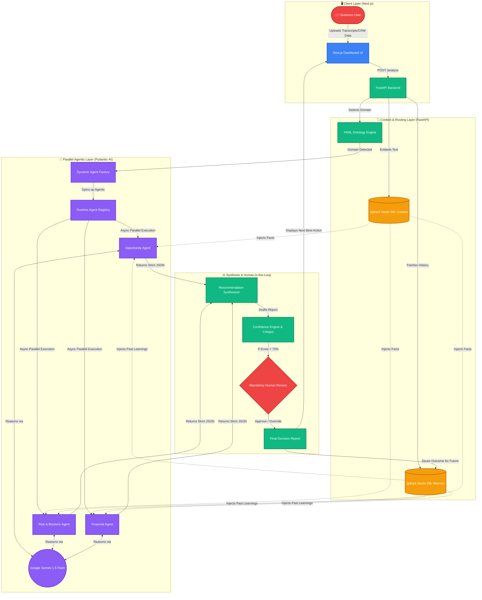

# DECISIONMESH AI Architecture

To present this in your video, simply click the "Preview" button in VS Code (usually at the top right of the editor) to render this diagram full-size on your screen!

